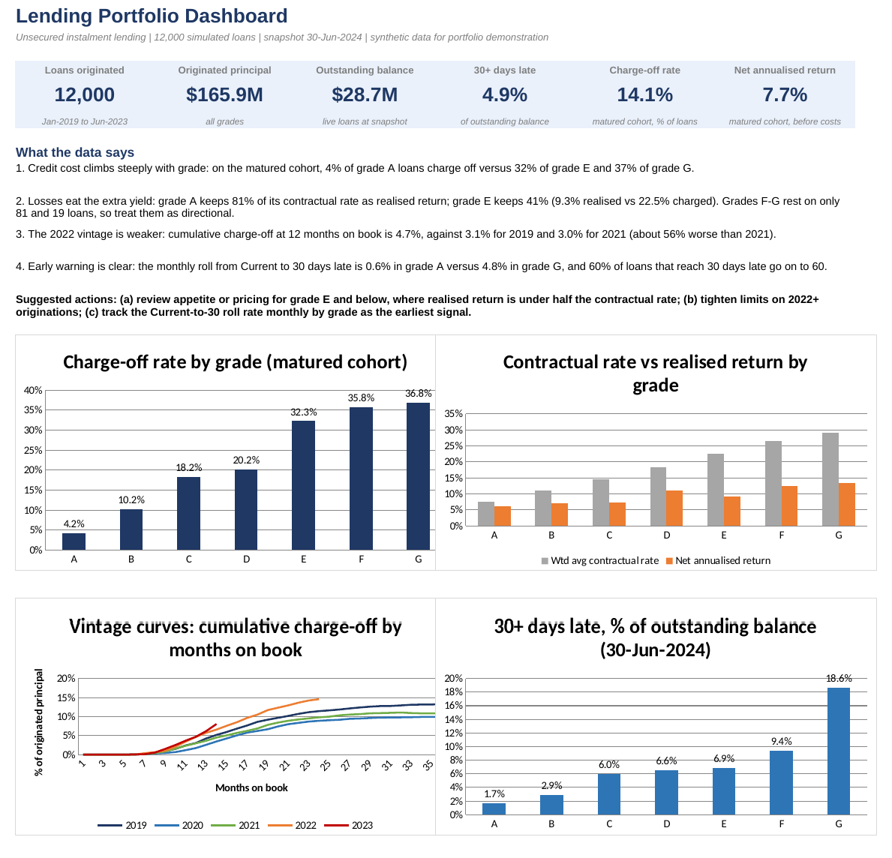
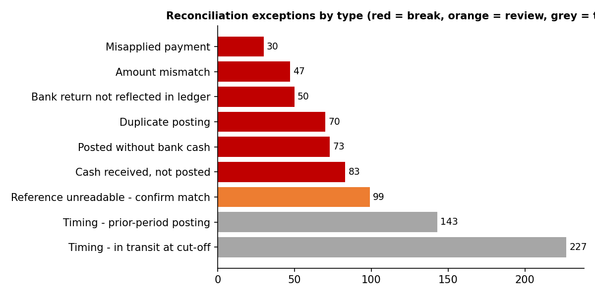

# Lending Portfolio Dashboard & Cash Reconciliation

An end-to-end finance-operations project in two parts, built with **SQL (SQLite), Python and Excel**:

1. **Lending portfolio analysis**: data validation, delinquency and roll rates, vintage loss curves and realised profitability by risk grade, delivered as an Excel KPI dashboard.
2. **Cash reconciliation**: a SQL matching engine that reconciles a loan-servicing ledger to a bank statement, classifies every exception by root cause, and produces an audit-ready exceptions report.

> **About the data.** All data is **synthetic**, generated by the scripts in `src/`. There is no real borrower or bank data, and the patterns are plausible rather than empirical, so none of the findings are evidence about any real lender. Synthetic data was a deliberate choice: public lending datasets don't include two independent transaction files, and generating the data lets me inject known errors and **score the reconciliation engine against an answer key**.



## Headline results

| | |
|---|---|
| Portfolio | 12,000 loans, $165.9M originated, $28.7M outstanding at 30-Jun-2024 |
| Data validation | 4 data issues found and logged in the raw file (72 duplicate loans, 144 missing incomes, 60 malformed grades, 48 impossible DTIs); 4 cross-file integrity checks all pass |
| Credit quality | On the matured cohort, charge-offs rise from **4%** (grade A) to **32%** (grade E) and **37%** (grade G) |
| Profitability | Grade A keeps **81%** of its contractual rate after losses; grade E keeps **41%** (9.3% realised vs 22.5% charged) |
| Vintages | The 2022 vintage's cumulative charge-off at 12 months on book is **4.7%** vs 3.0% for 2021 (about 56% worse) |
| Reconciliation | 14,493 ledger items vs 14,399 bank lines: **96% auto-matched**, 822 exceptions classified by root cause, owner and priority |
| Control check | The $147,569.93 ledger-to-bank difference is fully bridged to specific items: **$0.00 unexplained** |
| Engine accuracy | Flagged **449 of 449** injected breaks (446 labelled correctly); **0** break-class exceptions untraceable to an injected item |

## Repository layout

```
run_all.py                      one command rebuilds everything
src/
  generate_portfolio.py         synthetic loans + monthly repayment history
  generate_ledgers.py           ledger + bank statement, with injected breaks and an answer key
  run_pipeline.py               loads CSVs into SQLite, runs the SQL files in order
  build_dashboard.py            Excel dashboard (inputs from SQL, formulas for every ratio)
  build_exceptions_report.py    Excel exceptions report and tracker
  make_charts.py                PNG charts for this README
sql/
  00_create_tables.sql          typed input tables (run first for the SQL-only route)
  01_validation.sql             clean raw file, log every issue, integrity checks
  02_portfolio_kpis.sql         one row per loan outcome, grade KPIs
  03_vintage_rollrates.sql      vintage curves, roll-rate matrix
  04_profitability.sql          realised profitability on a matured cohort
  05_reconciliation.sql         rule-waterfall matching engine + exceptions register
  06_evaluation.sql             scores the engine against the answer key
excel/Lending_Portfolio_Dashboard.xlsx
reports/Reconciliation_Exceptions_Report.xlsx
reports/charts/  reports/tables/
data/                           input CSVs (monthly_performance.csv.gz is the compressed 26 MB file; run_all.py regenerates the CSV)
```

## How to run

```bash
pip install -r requirements.txt
python run_all.py          # about a minute; all seeds are fixed so results are reproducible
```

### Run it with SQL only (no Python needed)

All the data files are included in `data/`, and the finished Excel files are already built, so Python is only needed if you want to regenerate the synthetic data from scratch.

1. Open a new SQLite database (for example in [DB Browser for SQLite](https://sqlitebrowser.org/) or the `sqlite3` command line).
2. Run `sql/00_create_tables.sql` to create the empty input tables.
3. First unzip `data/monthly_performance.csv.gz` (it is compressed to keep the repo small). Then import each CSV from `data/` into its table (the mapping is in the header of that file): in DB Browser use *File > Import > Table from CSV file*, tick "column names in first line", and choose the existing table; in `sqlite3` use `.import --csv --skip 1 data/loans_raw.csv stg_loans_raw`, and so on.
4. Run `sql/01_validation.sql` through `sql/06_evaluation.sql` in order.
5. Query the results, for example `SELECT * FROM kpi_grade;`, `SELECT * FROM recon_results;` or `SELECT * FROM eval_summary;`.

This route was tested against the Python route and produces identical results for all 11 result tables.

## Part 1: Lending portfolio analysis

**Validation first (`01_validation.sql`).** The raw origination file is deliberately messy (text rates like `13.56%`, terms like ` 36 months`, `Jan-2019` dates, duplicates, blank incomes, DTI placeholders of 999, inconsistent grade casing). Each issue is counted, treated and logged in a `dq_log` table, followed by integrity checks between files: orphan records, interest + principal = payment, and a principal roll-forward on every loan (`loan amount = principal repaid + charged-off + closing balance`).

**Analysis (`02` to `04`).**
- *Delinquency and roll rates*: where do loans 30 / 60 / 90 days late go next month, and how does the Current-to-30 roll rate vary by grade (0.6% in grade A vs 4.8% in grade G)?
- *Vintage curves*: cumulative charge-off by months on book for each origination year, counting only loans old enough to be observed.
- *Profitability by grade*: interest collected + recoveries - charged-off principal, annualised over average balance.

**A methodological choice worth noting.** Recent loans haven't had time to default, so including them flatters the riskier grades. Profitability is therefore measured on a **matured cohort** (36-month loans issued Jan-2019 to Mar-2021) rather than the whole book.

**Excel dashboard.** SQL output enters the workbook as inputs (blue); every ratio, KPI and chart series is a live formula, so the workbook recalculates if the inputs change. The Dashboard sheet leads with findings and suggested actions rather than just charts.

## Part 2: Cash reconciliation

Two independent files for Q2-2024: the servicing ledger (what the system says was collected) and the bank statement (what arrived). Realistic frictions are built in and must be absorbed by the engine: weekend posting, 1-2 business-day settlement lag, card payments settling **net of fees**, and period cut-off effects.

**Matching engine (`05_reconciliation.sql`).** A rule waterfall where each rule only sees what earlier rules left unmatched, with one-to-one pairing (nearest date wins) so a duplicate posting cannot claim the same bank line twice:

| Rule | Logic | Outcome |
|---|---|---|
| R1 Exact | same loan ref, identical amount, date window | matched |
| R2 Card net of fee | amount = ledger x (1 - 1.5%) - $0.20 | matched, fee recorded |
| R3 Amount variance | same loan and window, amounts differ | exception |
| R4 Misapplied | bank ref and ledger loan differ, amount agrees | exception |
| R5 Fuzzy | bank reference unreadable, unique amount + date candidate | review |

Everything left is classified by cause: duplicate posting, posted without cash, cash not posted, bank return not reflected, or timing at the period edges. Parameters (fee schedule, windows, tolerances) live in a `recon_params` table rather than being hard-coded in the rules.

**Exceptions report.** 822 items with class (break / review / timing), root cause, recommended action, owner, priority, age and a status dropdown. The Summary sheet is formula-driven and includes a **bridge from the ledger total to the bank total** that must end at zero unexplained.



**Validating the engine.** Because the breaks were injected, the engine can be scored: 100% flagged, 99.3% labelled correctly. This is only possible with synthetic data; real reconciliations have no answer key.

## Limitations (stated honestly)

- Synthetic data with stylised vintage effects: findings illustrate the method, not the market.
- Grades F and G rest on small samples (81 and 19 loans in the matured cohort), so their ratios are directional.
- "Return" excludes funding and operating costs, so it is a credit-adjusted yield, not profit after costs.
- 3 of 50 injected amount errors were large enough (digit transpositions) to fall outside rule R3's 90% tolerance. They are still flagged, but as two separate unmatched items rather than one amount mismatch. An obvious next step is a post-pass pairing leftover ledger and bank items on the same loan.
- The 90-to-charge-off roll is 100% by construction of the simulated policy (charge-off after 4 missed instalments).

## Skills demonstrated

SQL (CTEs, window functions, rule-based matching, data validation) · Excel (formula-driven KPI dashboards, charts, trackers) · Python (pandas data generation and pipeline) · loan performance and delinquency analysis · reconciliation and exception management · audit-ready documentation.
